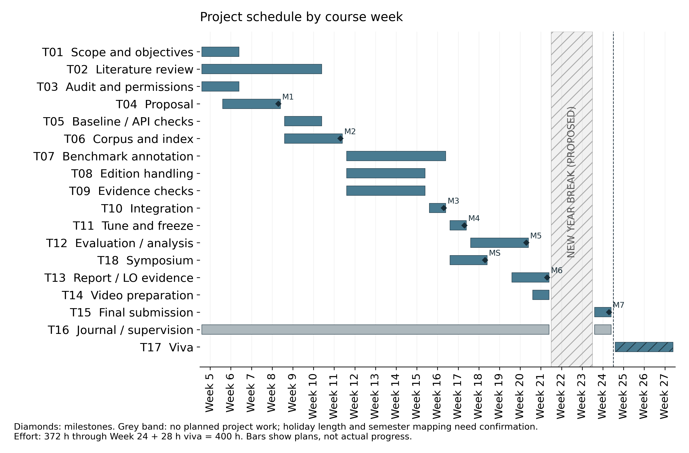

# ELEC3801 Project Proposal — IEEE Two-Column Final Version

Academic year: 2026–27. Prepared: 14 October 2026.

Status: final technical text; student details and factual declarations await completion before submission. Not submitted or approved. Future objectives and targets are not completed results.

Name and SID: [TO BE COMPLETED BY STUDENT]

Degree programme: [TO BE COMPLETED BY STUDENT]

Supervisor: Na Qin

Project title: Design and Evaluation of a Large Language Model-Based Question-Answering System for Railway Overhead Contact Systems

## Section 1: Project Description

### Background and problem

Chinese railway overhead contact system standards contain specialised terms, numerical limits and edition-dependent requirements. Answers must preserve editions, units and conditions.

Retrieval-augmented generation (RAG) connects retrieval and generation [1]. BM25 matches terms [2]; dense retrieval represents semantic similarity [3]. Query rewriting [4] informs rule-based follow-ups. Distractor research [5] motivates irrelevant-evidence tests, without establishing railway performance. RAGAs [6] motivates separate retrieval and answer assessment; semantic scoring here is manual.

### Aim, research questions and objectives

The aim is to develop and evaluate evidence-based question answering for these standards. RQ1: Does hybrid retrieval improve recall over BM25 and dense retrieval? RQ2: Does edition filtering reduce wrong-edition answers? RQ3: Does an evidence gate reduce unsupported answers without excessive refusal?

O1 — By Week 11, curate 20–30 usable documents, recording hashes, provenance, identifiers, years, extraction quality and permissions. Distinguish duplicates from formal editions. Seek two families with two usable editions each; availability remains unconfirmed. Exclude scans and drafts.

O2 — By Week 16, integrate PDF/DOCX parsing, chunking, SQLite, retrieval, DeepSeek generation, rule-based follow-ups and Streamlit. Locate citations by PDF file-page or DOCX paragraph/table. Missing requested editions require explicit refusal; ambiguous editions require clarification.

O3 — By Week 17, freeze 100 manually checked questions: 20 development (16 answerable) and 80 test (64 answerable). Cover clauses, terms, specified/missing/conflicting editions and follow-ups. Record facts, units, conditions and evidence spans in JSONL; keep related facts/dialogues within one split.

O4 — By Week 20, compare B1 BM25, B2 dense, B3 hybrid, A1 hybrid without edition filtering, and A2 hybrid without the retrieval gate. A1 retains family filtering but disables year restrictions and edition-availability/ambiguity checks. A2 retains prompts, citation checks and error handling. A2 measures only the gate's incremental effect.

O5 — By Week 24, deliver code, evaluation records, report, Portfolio and video; attend the Week 18 Symposium and prepare for the Week 25–27 viva.

### Reproducible method and assessment

Use consistent Chinese tokenisation for indexing and queries: an existing segmenter with a small domain dictionary, preserving standard identifiers, technical terms, numbers and units. No training is required. Freeze tokenisation and stopwords before testing.

Use Top-K=5, BM25 and cosine similarity. Min–max normalise scores across eligible chunks per query; combine as (1−w)B+wD. Constant positive scores map to one; other constant scores map to zero. Select w from {0.25,0.50,0.75} by development Recall@5, then MRR@5; ties favour 0.50. Select gate thresholds using development evidence labels only. Freeze corpus, models, prompts, chunking and parameters; automatically log inputs, outputs, evidence, configurations, tokens and timings.

Lexical coverage is matched distinct query content tokens divided by all distinct query content tokens, excluding standard identifiers and frozen stopwords; empty sets score zero. Matching uses passage tokens from the same segmenter. The gate accepts coverage or raw cosine above threshold. Metadata, citation identifiers and excerpt checks are automatic; semantic support, values, units and conditions require human assessment.

Recall@5 and MRR@5 use all 64 answerable items and pre-gate rankings. Correctness is fully correct answers/64; errors and refusals score zero. Citation support is supported cited claims/all cited claims, judging each claim's citations jointly; report citation coverage. Wrong-edition rate is answers using non-requested editions/all unambiguously edition-specified items, including missing editions; report availability strata and answer coverage. Refusal recall is justified non-answering/16 unanswerable items; false refusal is refusals or unnecessary clarifications/64 answerable items. Clarification is justified only for pre-labelled ambiguous items. API/format failures are errors, never justified refusals. Zero denominators yield N/A. Unsupported-answer incidence uses all 80 items.

Planning targets, not results: Recall@5 and correctness ≥0.80, citation support ≥0.90, refusal recall ≥0.80, false refusal ≤0.10. Report counts, paired differences, uncertainty, failures and latency.

### Feasibility and boundaries

A three-document BM25 prototype exists; live DeepSeek checks used synthetic evidence. Embedding, live dense/hybrid and formal evaluation remain unverified. Attribute reused code and APIs; develop calibration and annotation skills through development trials. Exclude training, agents, OCR, drawings, knowledge graphs, hardware and deployment. The system supports consultation, not engineering approval.

### References

[1] P. Lewis et al., “[Retrieval-Augmented Generation for Knowledge-Intensive NLP Tasks](https://papers.nips.cc/paper_files/paper/2020/hash/6b493230205f780e1bc26945df7481e5-Abstract.html),” in Advances in Neural Information Processing Systems, vol. 33, pp. 9459–9474, 2020.

[2] S. Robertson and H. Zaragoza, “The Probabilistic Relevance Framework: BM25 and Beyond,” Foundations and Trends in Information Retrieval, vol. 3, no. 4, pp. 333–389, 2009, doi: [10.1561/1500000019](https://doi.org/10.1561/1500000019).

[3] V. Karpukhin et al., “Dense Passage Retrieval for Open-Domain Question Answering,” in Proceedings of EMNLP, 2020, pp. 6769–6781, doi: [10.18653/v1/2020.emnlp-main.550](https://doi.org/10.18653/v1/2020.emnlp-main.550).

[4] X. Ma, Y. Gong, P. He, H. Zhao, and N. Duan, “Query Rewriting in Retrieval-Augmented Large Language Models,” in Proceedings of EMNLP, 2023, pp. 5303–5315, doi: [10.18653/v1/2023.emnlp-main.322](https://doi.org/10.18653/v1/2023.emnlp-main.322).

[5] F. Shi et al., “[Large Language Models Can Be Easily Distracted by Irrelevant Context](https://proceedings.mlr.press/v202/shi23a.html),” in Proceedings of ICML, PMLR, vol. 202, 2023, pp. 31210–31227.

[6] S. Es, J. James, L. Espinosa Anke, and S. Schockaert, “RAGAs: Automated Evaluation of Retrieval Augmented Generation,” in Proceedings of EACL: System Demonstrations, 2024, pp. 150–158, doi: [10.18653/v1/2024.eacl-demo.16](https://doi.org/10.18653/v1/2024.eacl-demo.16).

## Section 2: Gantt Chart

Week 1 begins on 7 September 2026, as confirmed in class. The confirmed Proposal deadline is Thursday 29 October 2026 (Week 8), with IEEE two-column presentation. The supplied course form specifies 14:00 UK time. Later date conversions assume consecutive weeks and remain provisional pending the semester timetable.

Reserve Week 22–23 (1–14 February 2027) as a provisional two-week Chinese New Year work break. Lunar New Year's Day is 6 February 2027; the institutional holiday length remains unconfirmed. No task bars cross the break. Budget 400 hours overall: 372 through Week 24 and 28 for the viva. This is a planning allocation, not completed work. The handbook states approximately 400 module hours but describes a Week 4–24 working period without explicitly allocating viva hours; the inclusive total here is a project budgeting choice, not a confirmed course interpretation.

Milestones: M1 Proposal (Week 8); M2 corpus/baseline (Week 11); M3 integration (Week 16); M4 frozen benchmark/configuration (Week 17); MS compulsory Symposium (Week 18); M5 evaluation (Week 20); M6 report draft (Week 21); M7 final submission (Week 24, Thursday 14:00 UK time, subject to the course notice). Viva: Week 25–27. Table I gives named tasks, active weeks, dependencies and hours. Equal predecessor-end and successor-start weeks mean an ordered handover within that week, not parallel dependency completion.

Main dependency chain: T03 → T06 → T07 → T11 → T12 → T13 → T15; integration also gates T11. Literature informs the Proposal through an initial reading checkpoint in Week 6, with the remaining T02 review continuing afterwards. T06 starts with document curation; T05 must be complete before its final embedding/index check at M2. T15 leaves 12 hours for final checks after the break; complete the report draft and video beforehand.

T16 covers ten formal supervision meetings, ten Review Documents (maximum two pages each) and weekly Progress Journal entries from Week 5 to Week 24 except examination weeks. Prepare each Review Document after its meeting and share it at least one day before the next; send Review Document 10 for approval before final submission. Hold the pre-Proposal review before Week 8. Meeting dates, approvals and holiday journal arrangements require agreement; the work break does not waive course requirements. Do not back-fill records.

## Section 3: Preliminary Resources Estimate

| Resource | Choice and justification | Cost / lead time | Limitation and alternative |
| --- | --- | --- | --- |
| Existing computer and storage | CPU parsing and a small local index; existing machine already runs the prototype. No training GPU needed. | £0 new hardware planned; available. | Measure memory and disk use on the selected corpus; reduce batch size if necessary. |
| Python, PyMuPDF, python-docx, NumPy, SQLite and Streamlit | Inspectable parsing, scoring and persistence; a local interface and evaluator share the pipeline. | £0 software purchase planned; environment working. | Complex layouts need manual checks. Review library licences before distribution. A larger vector database is unnecessary for this small corpus. |
| DeepSeek chat and a separate embedding API | Reuse verified chat access; online vectors avoid local model deployment. | Proposed combined ceiling £50; chat access verified, allow one week to verify embedding access. | Chat access does not provide a configured embedding service. Record model identifiers, cost units and availability before full runs. No guaranteed price or service continuity. |
| Standards and literature | Select 20–30 usable documents from local candidates; use six initial papers to justify design and assessment. | No new acquisition cost assumed; selection/permissions in Week 9–11. | Replace unusable or unauthorised files. Reserve 36 hours in T07 for structured questions and source checking; confirm usable edition pairs before M2. |
| Git and separate backup | Track code, labels and report changes; keep an independent approved backup. | £0 if existing storage suffices; Git already initialised. | Local Git alone is not a backup. Keep keys and restricted source documents out of published history. |

Budget basis: the main comparison contains 80 × 5 = 400 test executions, requiring at most 400 first-attempt generation calls. Early refusal/clarification can avoid generation; log actual calls separately. One development pass adds 20 × 5 = 100 executions, so one pass over all 100 questions totals at most 500 generation calls, not 400 + 500. Reserve a further 100 calls for bounded development and recovery: at most 600 planned new calls overall. Retries consume the reserve and retain their original failures; they are not extra scored test items. Retrieval-weight and gate-grid selection reuse cached development retrieval and need no generation. There is no routine repeated test sweep or LLM judge.

Embedding costs are separate: one corpus build, cached development/test query vectors and any logged rebuilds. Embedding access is planned, not verified. Estimate token use from a permitted pilot and actual provider units. Allocate £35 to generation, £10 to embeddings and £5 contingency: a £50 planning ceiling, not a verified quotation, observed charge or approved funding. Check model/pricing availability before runs and reassess at £40 (80%). Previous chat-check expenditure must be read from the account ledger. No reimbursement is assumed.

T07 allocates 36 hours: 4 hours for schema/pilot, 20 for drafting 100 narrow questions (12 minutes each), 10 for a separate source recheck (6 minutes each), and 2 for grouped splitting. T12 allocates 40 hours: 4 for automated runs/log checks, 20 for scoring 400 outputs (3 minutes each), 6 for reviewing 80 sampled/difficult outputs, 6 for analysis, and 4 contingency. Use one to three required facts per item and a shared rubric; AI may draft, but every gold answer needs human source verification. Mask configuration labels; identical answer-and-evidence tuples may reuse a checked judgement with traceable links. Pilot timings are unmeasured assumptions. If exceeded, use contingency and remove optional repeats, not source checking or difficult test items. Reuse the existing prototype and report skeleton to limit repeated setup and drafting. Preserve 36 hours for annotation, 40 for evaluation and 48 for journals, reviews and supervision within the 400-hour total, including viva.

Workshop/access: allocated laboratory bench — No; Mechanical Workshop — No; Electronics Workshop — No; special IT support — No currently anticipated; purchase of special electronic components — No. This is desktop software work. If hardware scope changes, consult the School's purchasing/manufacturing process before ordering and account for its lead times.

## Section 4: Professional Practice, Risk, and Compliance

### Societal and environmental considerations

User benefit is easier access to inspectable clauses. Wrong editions, numerical errors and omitted conditions could mislead users; the interface will show evidence and version labels and distinguish insufficient evidence from a supported answer. It will not certify compliance. No measured productivity or safety benefit is claimed.

Inclusion: provide readable Chinese text, labelled keyboard-operable controls, selectable evidence and status messages independent of colour. Test specialist terms and ordinary-language paraphrases. This first study does not establish English-language coverage or universal accessibility.

Sustainability: reuse hardware, avoid model training, cache unchanged vectors and limit unnecessary API reruns. Log available request/token counts as resource-use indicators; do not equate them with measured carbon emissions. Preserve configuration and documentation so the prototype can be maintained without rebuilding unchanged data.

### Ethics

Use technical documents and researcher-prepared questions; no participant recruitment or personal-data study is planned. Record provenance, confidentiality and permission for cloud processing before sending each document. A local permission toggle records a decision but does not establish legal permission. Exclude restricted material and engineering drawings from external processing in this phase. Check service retention conditions for permitted data.

Acknowledge the supplied reference implementation, literature and AI assistance in code and writing; keep development records. Do not present generated annotations, planned improvements or test targets as measured results. The applicable assessment brief governs permitted assistance. The unselected ethics options and signature fields follow below; the student and supervisor must determine the applicable option. Any later participant study requires review before recruitment.

### Risk Register

Likelihood/impact: L = Low, M = Medium, H = High. Initial ratings are planning judgements. The student owns all risks and will review triggers, actions and residual risk at each supervision meeting.

| ID / risk | L / I | Trigger, mitigation and affected tasks |
| --- | --- | --- |
| R1 Extraction failure | H / H | Scans, broken tables or lost units: audit pages, replace unsuitable files and log exclusions; no silent ingestion. T03/T06, before M2. |
| R2 Wrong edition or duplicates | H / H | Insufficient usable editions or metadata conflicts: TB/T 2073 and 2074 have local 2010/2020 candidates, but sampled 2010 files yielded no text. Their 2020 covers identify the superseded editions. Obtain permitted text editions or choose another family; exclude drafts and duplicate encodings. If two pairs cannot be verified by M2, retain A1 and report a limited case study; synthetic fixtures test code only, not empirical edition performance. T06/T08. |
| R3 Unsupported answers | M / H | Claims lack support or omit conditions: evidence gate, excerpt checks and manual semantic scoring; report false refusals. T09/T12. |
| R4 API/cost/model changes | M / H | Access fails, model changes or 80% cap reached: pilot early, cache vectors, log failures, freeze model identifiers and retain local retrieval. Verify embedding access in T05; integration buffer T10. |
| R5 Annotation/leakage | M / H | Ambiguous labels or related facts cross splits: grouped split, separate label recheck and immutable freeze before testing; mask configuration during scoring. T07/T11/T12. |
| R6 Data permissions | M / H | Cloud rights unresolved: keep affected files local and select authorised replacements before corpus freeze. T03/T06. |
| R7 Schedule/scope | M / H | Milestone slips: protect the provisional Week 22–23 break; prioritise five comparisons and finish report/video by Week 21, with Week 24 checks. Recheck date mapping and timed annotation/scoring pilots; keep OCR/drawings out of scope. T11–T15; preserve Symposium attendance. |
| R8 Data loss | L / H | Missing/corrupt files: version code and labels, back up to separate approved storage and test restoration. T16, throughout. |

If an alternative provider becomes necessary, repeat all affected comparisons with the same replacement configuration; do not mix favourable outputs from different models. A local retrieval demo is a fallback deliverable, not evidence that online QA or hybrid evaluation has passed.

### Security

Protect API credentials, permitted document content and evaluation labels. Keep keys in an ignored local environment file and out of exports; rotate any exposed key. Bind the demo to localhost. Treat retrieved text as untrusted data: it cannot change system rules or execute tools. Limit upload type/size, isolate parser errors and validate citation identifiers and excerpts. Keep the test set and experiment configurations versioned; minimise logs and back up restricted files only to approved storage.

### Safety

Specialist laboratory required: No. Work is desktop software and document analysis; there are no live railway, high-voltage, workshop or field experiments. Follow workstation ergonomics and normal computer electrical-safety procedures. Existing risk-assessment coverage / whether a new assessment is required: [TO BE CONFIRMED WITH SUPERVISOR].

### Declarations awaiting personal confirmation

The following wording is reproduced from the supplied Proposal Form for completion only after factual confirmation. Both ethics options are unselected; no approval, attendance or signature is asserted. Complete any separate official declaration or risk-assessment form required by the submission portal; these reproduced fields do not replace it.

[ ] My project does not involve human participants, personal data or other ethical issues requiring review.

[ ] My project involves human participants, personal data or other ethical issues. I have discussed this with my supervisor and will obtain ethical approval before starting that work.

Ethics option / discussion date: [TO BE COMPLETED].

My project work will not be covered by existing Risk Assessments. A new one is required. Yes [ ] / No [ ] — [PENDING SUPERVISOR CONFIRMATION]. Assessment reference and precautions, if applicable: [TO BE COMPLETED BEFORE PRACTICAL WORK].

Safety declaration — unsigned: “I have attended the Safety Briefing (included in the ELEC3801 introductory lectures) and my attendance was recorded. I am aware that full Risk Assessments relating to project work within the School have been conducted. I agree to comply with all the relevant safety policies.”

Safety briefing attendance/date: [UNCONFIRMED]. Student signature: ____________________ Date: __________.

Supervisor approval — not yet given: “My student has completed this form satisfactorily and is aware of their safety responsibilities.”

Supervisor signature or confirmation: ____________________. Date: __________. Means (signature / verbal / email / Teams): [TO BE COMPLETED AFTER REVIEW].
