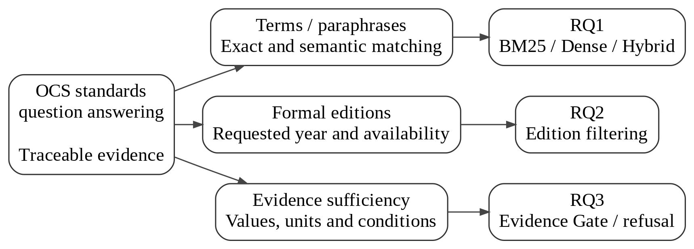
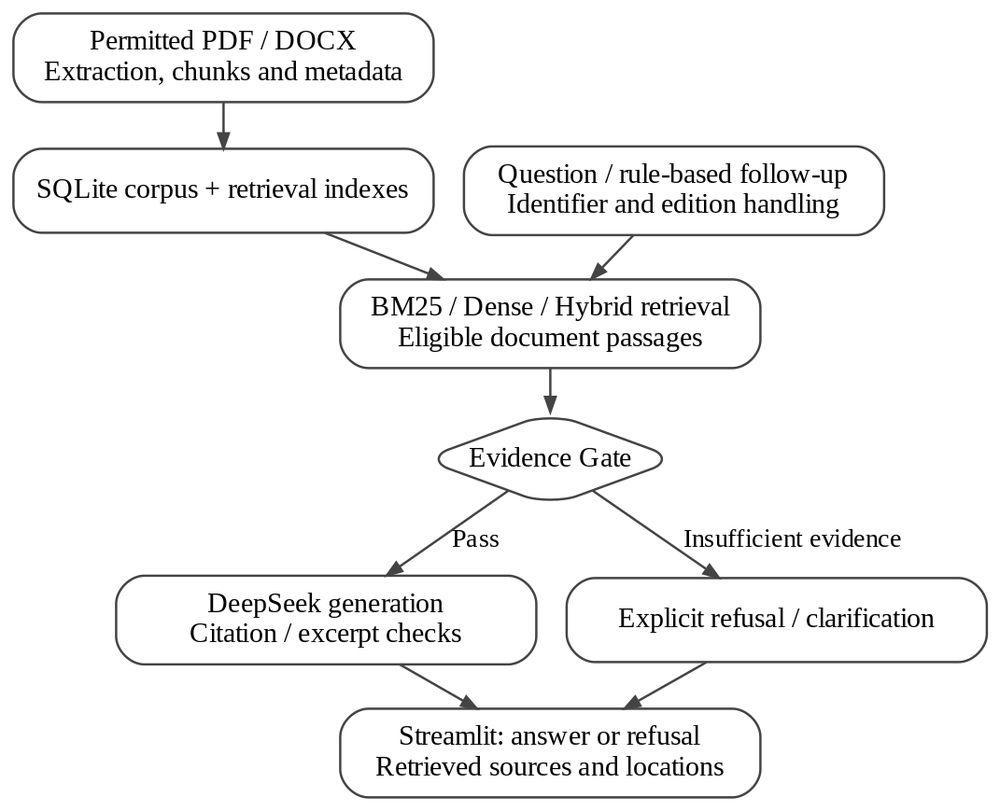
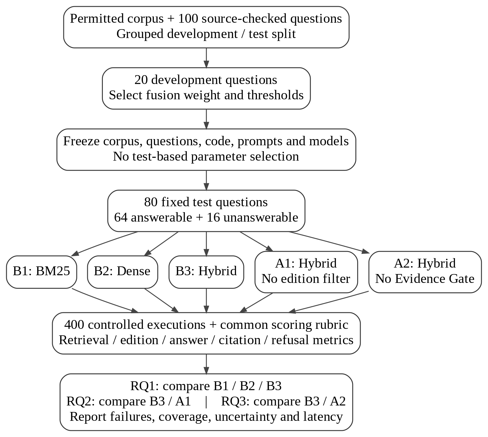

# 交大开题报告内容源（按示例重排，附件九优先）

Prepared on: 2026-10-30

Student name: 黄俊凯

Student ID: 2023115799

Degree programme: Electronic and Electrical Engineering

Supervisor: 黄德青

Supervisor rank: 教授

Project type:

Topic source:

Guidance journal:

Project title: A Study on a Large-Model-Based Intelligent Question-Answering System for the Overhead Contact System Field

## 选题意义和国内外研究现状分析

### 1. Background and Significance

#### 1.1 Research background

Chinese railway overhead contact system standards contain specialised terminology, numerical limits and edition-dependent conditions. A user may need to locate a technical requirement, identify its applicable edition and check the original clause. Keyword searches can miss paraphrased questions, while fluent model answers can omit qualifications or cite an inappropriate edition. These difficulties motivate a retrieval-augmented generation (RAG) system that combines document search with evidence-grounded answers.

The research object is the technical information contained in standards, rather than the physical operation of railway equipment. The supplied candidate corpus includes TB/T 2073-2020, covering technical requirements for overhead contact system fittings, and TB/T 2074-2020, covering test methods. Their forewords identify earlier editions and technical changes. This illustrates why a question about a requirement, its test method and its edition cannot be resolved by treating every document mentioning the same component as interchangeable. These candidate files do not establish that all required edition pairs are usable or permitted for online processing.

This study will focus on permitted PDF and DOCX standards. It will retain standard identifiers, years and source locations so that users can inspect the retrieved passages. An available file will not automatically be treated as a valid current standard: provenance, edition and extraction quality must first be recorded. PDF file-page numbers and DOCX paragraph/table locations will distinguish an answer's source from a plausible but untraceable explanation.

#### 1.2 Research significance

The intended engineering benefit is more traceable study and document consultation. A user should be able to move from a question to a concise answer and then to its supporting passage. This is particularly useful when a short question omits terminology used in the original text or when a numerical statement is valid only under particular conditions. Displaying a source location allows the original requirement to remain available for inspection.

The research significance is to separate three possible causes of failure: not retrieving the evidence, retrieving the wrong edition, and generating an answer without sufficient support. A working interface alone cannot distinguish these causes. Controlled retrieval comparisons and two targeted ablations will show which component contributes to observed behaviour and where the proposed checks remain insufficient. Improvements will be reported only when supported by the fixed test set.

The project also provides an achievable engineering study within undergraduate time and resource limits. Existing parsing libraries, retrieval tools and online APIs will be combined with explicit metadata and evaluation rules. No new model will be trained. The system will support learning and consultation; it will not certify compliance, issue maintenance instructions for operational use or authorise railway operations.

#### 1.3 Domain challenges and proposed response

Three connected challenges define the study, as summarised in Fig. 1-1. First, exact identifiers and specialised terms favour lexical matching, whereas paraphrased descriptions may require semantic matching. Second, an otherwise relevant clause can belong to a different formal edition. Third, a retrieved passage can mention the correct topic without supporting the requested conclusion. Retrieval relevance, edition compatibility and answer support therefore require separate checks and measurements.

Document quality is a further practical constraint. Incomplete extraction or a chunk boundary can detach a limit from its unit or condition. Recording extraction failures and retaining source locations will make these limitations visible. The benchmark will include answerable and deliberately unanswerable cases so that refusal is evaluated alongside successful answering. Neither a high similarity score nor the presence of a citation will be treated as automatic proof of correctness.

### 2. Review of Related Research

#### 2.1 Retrieval-augmented generation and lexical retrieval

Lewis et al. combine parametric language generation with retrieved external information [1]. Their work addresses the difficulty of accessing and updating knowledge held only in model parameters. It provides the architectural motivation for grounding answers in a document collection. The original work includes model fine-tuning; the present project will use an existing API and evaluate the retrieval-and-evidence workflow, rather than reproduce that training procedure. Retrieval and answer quality need separate evaluation because relevant context does not guarantee faithful generation.

Robertson and Zaragoza describe BM25 within the probabilistic relevance framework [2]. BM25 scores term matches using term-frequency and document-length effects, providing an interpretable lexical baseline. In this project, exact standard identifiers, technical terms and numerical expressions make it an appropriate starting point. However, a question using different wording may have limited lexical overlap with its evidence. Consistent Chinese tokenisation is therefore required at indexing and query time, while semantic matching must be assessed separately.

#### 2.2 Dense and Hybrid retrieval

Karpukhin et al. use dense question and passage representations to retrieve evidence for open-domain question answering [3]. This supports investigating semantic retrieval when questions paraphrase a document. Their benchmark results are not evidence of performance on Chinese railway standards. In this setting, similar passages can still differ in numerical limits, applicable conditions or edition. A relevant-looking vector neighbour must therefore be checked against the required evidence and metadata.

Hybrid retrieval will combine lexical and vector scores so that the study can test whether their different matching behaviour is complementary. Fusion is an engineering hypothesis, not an assumed improvement. All three retrieval methods will use the same eligible chunks, source-checked questions and top-five evaluation depth. Any improvement must therefore be attributed with regard to the chosen corpus, preprocessing and development-selected settings.

Ma et al. investigate query rewriting to reduce the gap between an input question and the knowledge needed by a reader [4]. Their framework includes a trained rewriter. The present project adopts only the motivation to preserve useful question context: follow-ups will use limited rules, without an additional model, training stage or agent. This keeps retrieval comparison interpretable and the workload bounded.

#### 2.3 Evidence relevance and answer evaluation

Shi et al. demonstrate distractibility using an arithmetic benchmark containing irrelevant context [5]. The study motivates examining context relevance, but its results cannot be transferred directly to this domain. Here, an unrelated or insufficient passage should produce a refusal or clarification rather than become a prompt for an unsupported technical answer. The consequences of this policy must be measured on both unanswerable and answerable questions.

RAGAs distinguishes retrieval quality, faithful use of context and generation quality [6]. This separation informs the planned metric groups. The project will not adopt its automatic assessment framework or add an LLM judge. Human scoring against fixed source evidence will determine whether an answer preserves required facts, values, units and conditions. Automatic citation-number and literal-excerpt checks will identify structural failures; they will not be described as semantic fact verification.

#### 2.4 Chinese-language research and project focus

Feng et al.'s Chinese-language survey discusses retrieval timing, retrieval methods, evidence use, datasets and evaluation [7]. Its broad treatment shows why document retrieval and generation should be examined together, while leaving application-specific choices to be tested. For this project, Chinese preprocessing, standard identifiers and formal editions are the relevant design constraints. The survey does not establish effectiveness for the selected overhead contact system standards, nor demonstrate that the candidate corpus is complete.

#### 2.5 Synthesis and research gap

The reviewed work supports a document-grounded architecture and separate evaluation of retrieval and answers. The remaining project question is how these ideas behave together under edition-dependent technical queries and limited evidence. This is a bounded application study rather than a claim that no railway question-answering research exists. RQ1 will compare retrieval mechanisms; RQ2 will isolate edition filtering; RQ3 will assess the balance between unsupported answers and excessive refusal. The contribution will be the curated evidence set, controlled comparisons and documented failure analysis.

## 主要研究目标和研究内容

### 3. Research Aim and Objectives

The aim is to design and evaluate a RAG system with local document retrieval for Chinese overhead contact system standards. The research questions are:

RQ1: Does Hybrid retrieval improve evidence recall compared with BM25-only and Dense-only retrieval?

RQ2: Does standard-edition filtering reduce answers based on a non-requested edition?

RQ3: Does an Evidence Gate reduce unsupported answers without excessive refusal of answerable questions?

O1: By Week 11, curate 20–30 usable documents, recording provenance, permissions, hashes, identifiers, editions and extraction quality. Seek two families with two formal editions each; distinguish duplicates from editions and exclude unsuitable scans/drafts.

O2: By Week 16, verify PDF/DOCX parsing, chunking, SQLite, retrieval, DeepSeek, rule-based follow-ups and Streamlit. Cite PDF file-pages or DOCX paragraphs/tables; refuse missing editions and clarify ambiguous editions.

O3: By Week 17, freeze 100 source-checked questions: 20 development items (16 answerable) and 80 test items (64 answerable). Record required facts, units, conditions and evidence spans; keep related facts and dialogues within one split.

O4: By Week 20, compare B1 BM25, B2 Dense, B3 Hybrid, A1 Hybrid without edition checks, and A2 Hybrid without the Evidence Gate. A1 retains standard-family filtering; A2 retains prompts, citation validation and error handling. All five use the same frozen corpus, questions and generation configuration.

O5: By Week 24, deliver the system, reproducibility records, report, Portfolio and video; attend the Week 18 Symposium and prepare for the Weeks 25–27 viva.

### 4. Research Content and Methods

#### 4.1 Document processing and system organisation

The planned workflow is shown in Fig. 4-1. PDF/DOCX extraction, chunking and metadata storage will support retrieval; evidence checks will precede generation, and the interface will display answers with traceable sources. Scanned pages and failed extractions will be registered explicitly rather than silently treated as processed. SQLite will retain the records required to associate each passage with its document, edition and location. Document hashes will distinguish duplicate files from different formal editions. The same chunk set and metadata rules will feed all retrieval configurations, so a comparison does not inadvertently change the evidence available to one method.

#### 4.2 Retrieval comparison and parameter selection

Use consistent Chinese tokenisation and a small domain dictionary, preserving identifiers, technical terms, numbers and units. For Hybrid retrieval, min–max normalise BM25 and cosine scores over eligible chunks and combine them as (1−w)B+wD. Constant positive scores map to one; other constants map to zero. Select w from {0.25, 0.50, 0.75} using development Recall@5, then MRR@5, with ties favouring 0.50. Select gate thresholds on development data only; freeze all settings before testing. Record the segmenter, domain dictionary, chunk settings, embedding model and fusion rule with the experiment configuration. Qualitative development cases will help explain exact-term and paraphrase failures, but test outcomes will not be used to choose parameters.

#### 4.3 Standard-edition handling

Normalise identifiers and years in document metadata and questions. Test explicitly requested editions, missing editions and conflicting edition information. A duplicate file is not a second formal edition. The edition-filter ablation will retain standard-family filtering so that it isolates edition handling. If usable edition pairs are insufficient, report a limited case study and retain A1 without claiming broad multi-edition validity. Missing requested editions must remain unanswerable rather than silently falling back to a different year. Results will distinguish usable-edition queries from missing-edition queries, so a lower wrong-edition rate cannot be interpreted without considering answer coverage.

#### 4.4 Evidence Gate and citation checks

Lexical coverage is the proportion of distinct query content tokens matched in passage tokens, excluding identifiers and fixed stopwords; empty sets score zero. The gate accepts coverage or raw cosine similarity above the respective development-selected threshold. Metadata, citation numbers and literal excerpts are checked automatically; semantic support requires human judgement, including numerical values, units and applicable conditions. Evidence rejected by the gate will lead to an explicit refusal or appropriate clarification. Test cases will include irrelevant passages, insufficient passages, missing editions and ambiguous follow-ups. The gate may reject useful evidence or accept superficial overlap; these errors will be examined through refusal metrics and manual analysis, rather than presented as a solved fact-checking problem.

#### 4.5 Benchmark and controlled evaluation

The controlled evaluation is organised around the three research questions in Fig. 4-2. The main experiment contains 80×5=400 executions. Manual scoring will use a shared rubric and masked configuration labels. Recall@5 and MRR@5 use pre-gate rankings for all 64 answerable test items. Correctness is fully correct answers/64; false refusal is refusals or unnecessary clarifications/64. Refusal recall is justified non-answering/16 unanswerable items. Citation support is supported cited claims/all cited claims; report citation coverage separately.

Wrong-edition rate is answers using non-requested editions/all unambiguously edition-specified items, including missing editions; report availability strata and answer coverage. API/format failures are errors, not justified refusals; zero denominators are N/A. Unsupported-answer incidence uses all 80 test items. Report counts, paired differences, uncertainty, latency and failures. Targets, not results: Recall@5 and correctness ≥0.80, citation support ≥0.90, refusal recall ≥0.80 and false refusal ≤0.10.

Each question record will contain its split, answerability, requested edition, required facts and source locations. A common scoring form will be reused across configurations; configuration labels will be masked during manual review where practical. Logs will capture retrieved chunk identifiers, ranks, scores, edition decisions, gate outcomes, answers, citations, model settings and stage timings. This reduces repeated annotation and supports reconstruction of a failed case without rerunning a test until a preferred answer appears.

#### 4.6 Feasibility, risks and boundaries

BM25 and synthetic DeepSeek checks support feasibility; embedding access and formal evaluation remain unverified. Only permitted text may leave the device. Log extraction and API failures; keep local retrieval available and limit edition conclusions when usable pairs are insufficient. Track cost and schedule against the £50 and 400-hour budgets. Use existing CPU hardware. Scope excludes model training, OCR, drawings, agents, knowledge graphs, hardware development and deployment.

## 工作计划及进度安排

### Work Plan and Schedule

Weeks follow the signed ELEC3801 Proposal; later semester dates and Chinese-side checkpoints follow official notices. Corpus review and integration must precede configuration freeze; controlled testing must precede final interpretation and reporting.

#### Weeks 5–11: Planning, corpus and baseline

T01–T04 cover scope, sample/permission review and the Week 8 Proposal milestone (M1); T02 literature work continues to Week 10. T05/T06 verify the environment and separate embedding access. At Week 11 (M2), audit the 20–30-document target, usable edition pairs, source locations and BM25 baseline; record unmet criteria.

#### Weeks 12–17: Validation and freeze

T07/T08/T09 cover source-checked questions, edition handling, evidence checks and development-case Dense/Hybrid comparisons. T10 completes integration and failure-path checks at Week 16 (M3). T11 freezes corpus, questions, code, prompts, models and five configurations at Week 17 (M4), after development-only tuning.

#### Weeks 18–21: Evaluation and reporting

T18 covers the compulsory Week 18 Symposium. T12 completes five comparisons and manual scoring by Week 20 (M5). T13/T14 prepare the report draft, learning-outcome evidence, Portfolio and video by Week 21 (M6).

#### Weeks 22–27: Break, submission and viva

Weeks 22–23 are the planned project break, 1–14 February 2027, subject to course journal/supervision requirements. T15/T16 complete final checks and notified submissions in Week 24 (M7); T17 covers the Weeks 25–27 viva. These planning weeks do not establish an approved institutional calendar.

#### Effort and resources

T16 maintains genuine weekly records, supervision and ten Review Documents. Planned effort remains 372 hours through Week 24 plus 28 for the viva: 400 hours, including annotation 36, evaluation 40 and process records 48. These are budgets, not completed hours.

The 400 main executions plus 100 development executions allow at most 500 first-attempt generations, with 100 reserve calls. Early refusals can avoid generation; log actual calls, failures and retries separately. Allocate £35 to generation, £10 to embeddings and £5 contingency; review at £40. Acknowledge reused code and AI assistance.

## 参考文献

[1] P. Lewis et al., “Retrieval-Augmented Generation for Knowledge-Intensive NLP Tasks,” in Advances in Neural Information Processing Systems, vol. 33, pp. 9459–9474, 2020.

[2] S. Robertson and H. Zaragoza, “The Probabilistic Relevance Framework: BM25 and Beyond,” Foundations and Trends in Information Retrieval, vol. 3, no. 4, pp. 333–389, 2009. doi: 10.1561/1500000019.

[3] V. Karpukhin et al., “Dense Passage Retrieval for Open-Domain Question Answering,” in Proceedings of EMNLP, pp. 6769–6781, 2020. doi: 10.18653/v1/2020.emnlp-main.550.

[4] X. Ma, Y. Gong, P. He, H. Zhao, and N. Duan, “Query Rewriting in Retrieval-Augmented Large Language Models,” in Proceedings of EMNLP, pp. 5303–5315, 2023. doi: 10.18653/v1/2023.emnlp-main.322.

[5] F. Shi et al., “Large Language Models Can Be Easily Distracted by Irrelevant Context,” in Proceedings of ICML, PMLR, vol. 202, pp. 31210–31227, 2023.

[6] S. Es, J. James, L. Espinosa Anke, and S. Schockaert, “RAGAs: Automated Evaluation of Retrieval Augmented Generation,” in Proceedings of EACL: System Demonstrations, pp. 150–158, 2024. doi: 10.18653/v1/2024.eacl-demo.16.

[7] Z. Feng, K. Zhu, W. Ma, L. Huang, B. Qin, T. Liu, and X. Feng, “Enhancing Large Language Models with Retrieval-Augmented Techniques: Trends, Challenges, and Prospects,” in Proceedings of the 23rd Chinese National Conference on Computational Linguistics (Volume 2: Frontier Forum), pp. 151–168, 2024 (in Chinese). https://aclanthology.org/2024.ccl-2.9/
