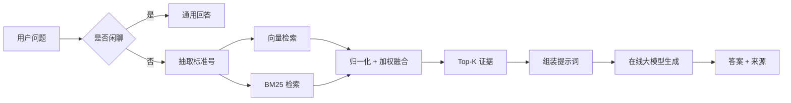

# 论文写作建议

本文件帮助把"一个 RAG 系统"写成一偏合格的本科毕业设计论文，
给出**章节大纲、可复用图表、实验设计、创新点提炼与常见坑**。

---

## 一、建议的论文结构（可按学校模板调整）

| 章 | 标题 | 主要内容 | 可用素材 |
| --- | --- | --- | --- |
| 第1章 | 绪论 | 研究背景与意义、国内外研究现状、主要工作、论文结构 | 参考文献 1、29、31 |
| 第2章 | 相关技术 | Transformer / BERT 表示、稠密检索、BM25、向量索引、大模型与提示学习、RAG 范式 | 参考文献 2、5、6、10、16、31、33、35 |
| 第3章 | 系统需求与总体设计 | 需求分析、非功能需求、总体架构、模块划分、数据流 | `03_技术说明/系统设计说明.md` |
| 第4章 | 系统详细设计与实现 | 文档解析与清洗、切块、在线向量化、混合检索与融合、提示词与生成、多轮记忆、界面 | `01_主要代码/` |
| 第5章 | 系统测试与实验 | 功能测试、检索效果评测、消融实验、响应时间、案例分析 | 见下文"实验设计" |
| 第6章 | 总结与展望 | 工作总结、局限、未来工作 | 可扩展方向 |

---

## 二、可复用的图表

### 图

1. **总体架构图**：离线建库 + 在线问答两条链路（见 `系统设计说明.md`）。
2. **数据流图**：`文档 → 解析 → 切块 → 向量化 → 入库`。
3. **检索流程图**：`问题 → 标准号抽取 → 向量检索 + BM25 → 归一化融合 → Top-K`。
4. **模块依赖图**：config / online_api / document_parser / vector_store / rag_pipeline。
5. **界面截图**：`web_app.py` 运行后的问答界面与来源展开。

### 表

1. **参数配置表**（见 `系统设计说明.md` 第五节）。
2. **混合检索消融表**：仅向量 / 仅 BM25 / 融合，对比 Recall@K、MRR。
3. **响应时间表**：检索耗时 / 生成耗时 / 端到端耗时。
4. **典型案例表**：问题 → 召回来源 → 答案是否被正确来源支撑。

> 建议用 draw.io、Mermaid 或 Visio 画图；Mermaid 示例（可贴进 Typora/支持 mermaid 的工具）：

---

## 三、实验设计（第5章的重点）

本科生毕设的实验不必追求 SOTA，但**要有对比、有数据、有分析**。

### 1. 评测集构建

- 人工从知识库中选取 **30–50 个问题**，覆盖：
  - 条文/技术条件类问答
  - 标准号定位类（如"TB/T 2075 中线夹的要求"）
  - 术语解释类
  - 多轮追问类
  - 知识库外问题（考察拒答/兜底）
- 每个问题标注**正确答案片段所在的文件与页码**，作为检索的"标准答案"。

### 2. 评价指标

检索侧：

- **Recall@K**：正确答案是否出现在前 K 个结果中；
- **Precision@K**：前 K 个结果中相关片段的比例；
- **MRR**：第一个正确结果排名的倒数均值。

生成侧：

- **答案准确率**：人工判定答案是否被来源正确支撑；
- **引用准确率**：给出的 `[来源n]` 是否真的支撑该结论；
- **拒答正确率**：知识库外问题是否正确兜底而非硬答。

> 可参考 RAGAS（参考文献 27）的思想：忠实度、答案相关性、上下文相关性。

### 3. 消融实验（推荐重点）

固定同一评测集，对比三种检索策略：

| 配置 | Recall@5 | MRR | 说明 |
| --- | --- | --- | --- |
| 仅向量检索 | ? | ? | 语义好、字面词弱 |
| 仅 BM25 | ? | ? | 字面准、同义弱 |
| **向量 + BM25 融合** | ? | ? | 取长补短 |

再调节 `VECTOR_WEIGHT` / `BM25_WEIGHT`（如 0.2/0.8、0.5/0.5、0.8/0.2），
画一条"权重—指标"曲线，说明权重选择依据。

### 4. 案例分析

挑选 3–5 个典型问题，展示召回来源与答案，说明"为什么这样排序合理/不合理"。

---

## 四、创新点/工作点的提炼（避免"只是调了个 API"）

本科毕设的"创新"不一定要提出新算法，**清晰的问题—方案—验证**同样成立。可这样表述：

1. **面向规范文档的检索线索抽取**：利用标准号、页码等结构化线索做检索过滤，
   缓解规范文档"语义相近但标准不同"的误召回。
2. **向量 + BM25 的混合检索与加权融合**：在同一套候选上双路打分并归一化融合，
   兼顾语义与字面匹配，并用消融实验证明其有效性。
3. **面向低置信场景的兜底与幻觉抑制**：通过提示词约束与"检索不到不硬答"策略，
   降低错误引用率。
4. **工程解耦设计**：向量化与生成统一封装为在线服务接口，系统不依赖本地模型，
   便于部署与模型替换。

> 若还实现了"可扩展方向"中的 1–2 项（动态标准号过滤、对比类分标准召回等），
> 可作为**第 4 个创新点**，并补充对应的消融数据。

---

## 五、常见坑与提醒

1. **不要把"调 API"当创新**——重点写清楚你自己做的部分：切块策略、融合权重、
   评测集与实验分析。
2. **实验要有基线**——至少给出"仅向量"和"仅 BM25"两个基线。
3. **引用要可追溯**——论文里的每篇引用都要在正文出现；
   参考文献清单中的 arXiv 编号提交前务必复核。
4. **图表要自洽**——文中提到的每个数字都要能在图/表里找到出处。
5. **代码与论文对应**——第4章描述的实现应与 `01_主要代码/` 一致，
   函数名、参数名保持统一，方便答辩时对照演示。
6. **注意学术诚信**——直接引用他人工作需标注来源，代码中使用开源库需遵循其许可证。

---

## 六、答辩演示建议

1. 用 `selftest.py` 先证明算法链路正常（不耗额度、秒级完成）；
2. 用 `build_kb.py` 现场导入一份文档；
3. 用 `web_app.py` 演示提问、来源展开、追问；
4. 准备 2–3 个"知识库外问题"演示兜底，体现幻觉抑制设计。
